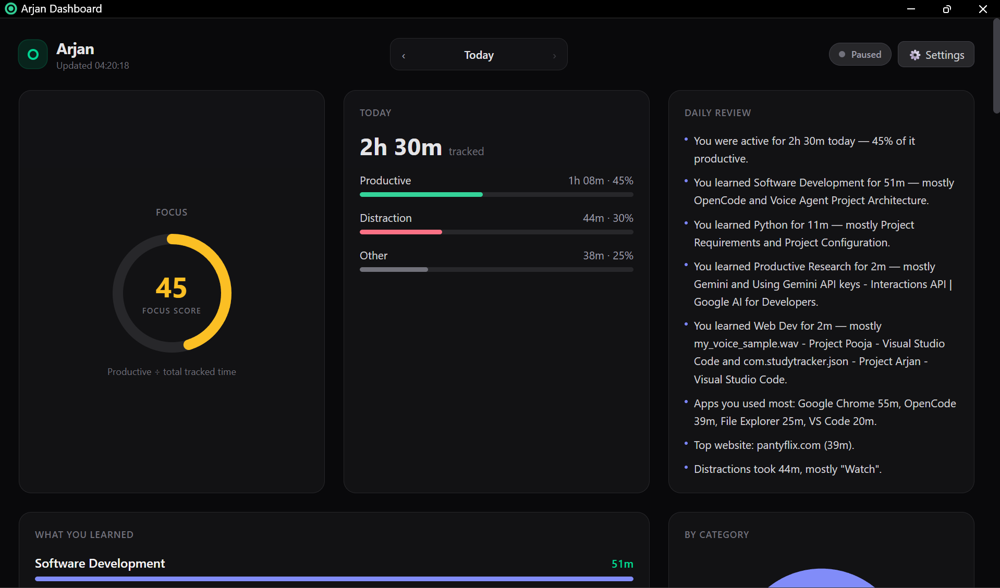
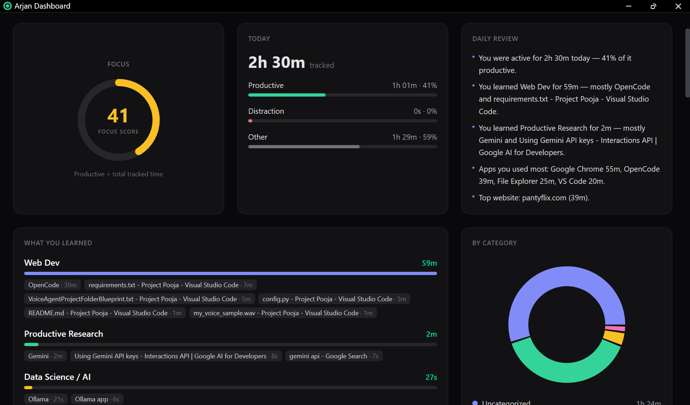
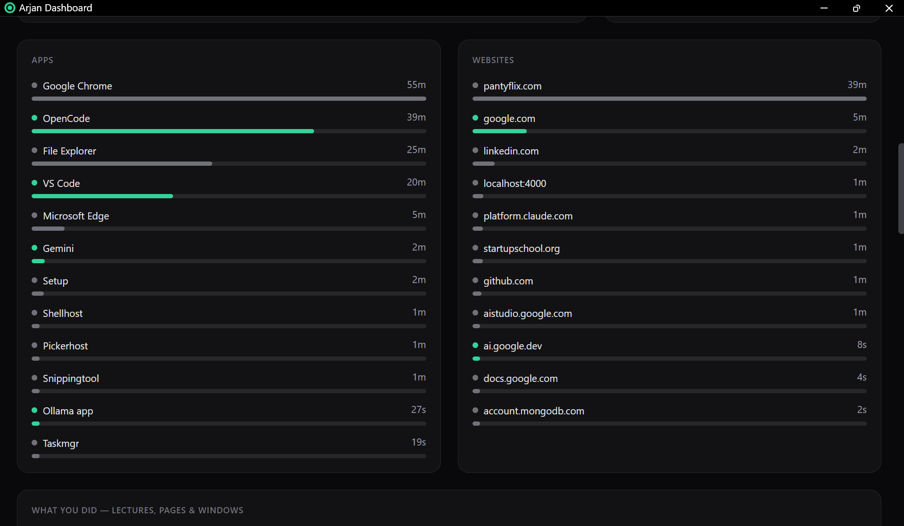
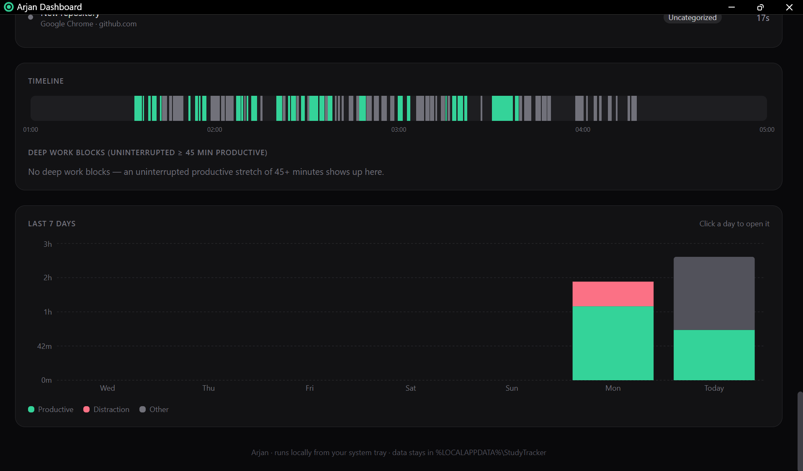

# Arjan — Study & Laptop Usage Tracker

Arjan lives in your **system tray**, quietly records which apps, websites,
lectures and windows you spend time on, and shows you **where your day went**
and **what you actually learned** — on a local dashboard, one click away.

- 🟢 **Tray app** — starts with Windows, no terminal, no `npm run dev`. ~25 MB RAM, ~0% CPU.
- 🧭 **Where your time went** — per app (VS Code, OpenCode, Gemini…), per website, and per
  activity ("*Linear Regression | Week 3 — YouTube*, 45 min").
- 🎓 **What you learned** — time per subject with topics, e.g.
  *"You learned Machine Learning for 1h 20m — mostly Gradient Descent and Linear Regression."*
- 🤖 **AI categorization (optional)** — uses Gemini (free key), OpenAI, OpenRouter, Groq, or a
  fully local Ollama to work out the subject of each lecture/page/window.
- 📊 **Focus Score**, category donut, day timeline, deep-work blocks, last-7-days chart.
- 🔔 **Notifications** — 9 PM daily report, and a nudge after 15 minutes of continuous distraction.
- 🔒 **Local-first** — everything stays on your laptop (AI is opt-in; see [Privacy](#privacy--security)).



## Screenshots

| | |
| --- | --- |
| **What you learned** — productive time per subject, with the pages and files behind it | **Apps & websites** — ranked, green when the time was productive |
|  |  |
| **Timeline & last 7 days** — your day as a colored strip; click a bar to open that day | |
|  | |

---

## Quick start

**Needed once, to build:** Windows 10/11, [Go 1.22+](https://go.dev/dl/) and
[Node.js 20+](https://nodejs.org/). (Only `tracker.exe` runs day to day — not Node.)

### 1. Build & launch

```powershell
cd "C:\Users\Pratham Prajapati\Machine Learning Projects\Project Arjan"
powershell -ExecutionPolicy Bypass -File build.ps1
```

This builds everything into `dist\`, turns on **Start with Windows**, and starts Arjan.
Look for the **green ring icon** in the system tray (click `^` if it's hidden — drag it
onto the taskbar to keep it visible).

- **Left-click** the icon → the dashboard opens in its own window.
- **Right-click** → menu.

### 2. Connect your browser (one time)

Without this, browsers are recorded only by window title. With it, Arjan sees the exact
page/lecture you're on.

1. Open `chrome://extensions` (or `edge://extensions`) → turn on **Developer mode** →
   **Load unpacked** → select the `extension\` folder.
2. Copy the extension **ID** shown on that page.
3. Open `host\com.studytracker.json` and replace `REPLACE_WITH_YOUR_EXTENSION_ID`
   (keep the trailing `/`). For both Chrome and Edge, add both IDs to `allowed_origins`.
4. Run `powershell -ExecutionPolicy Bypass -File install-host.ps1`
5. **Fully restart** the browser.

### 3. Turn on AI categorization (optional, recommended)

Dashboard → **⚙ Settings** → enable **AI categorization**:

1. Provider: **Google Gemini** (free tier).
2. Get a key at **<https://aistudio.google.com/apikey>** and paste it in **API key**.
3. Click **Test connection** — you should see a lecture classified as *Machine Learning*.
4. Click **Classify now** (after that it runs automatically every 5 minutes).

Prefer total privacy? Install [Ollama](https://ollama.com), run `ollama pull llama3.2`,
and choose **Ollama (local, private)** — no key, nothing leaves your laptop.

---

## Using it

### Tray menu

| Item | What it does |
| --- | --- |
| *Today 3h 12m · Focus 75* | Live summary (updates every minute) |
| **Open Dashboard** | Opens / focuses the dashboard window (same as left-click) |
| **Pause tracking** | Stops recording until you resume (icon turns grey) |
| **Start with Windows** | Toggle auto-start at sign-in |
| **Show today's report** | Today's summary as a notification |
| **Open data folder** | Database, logs, settings |
| **Quit Arjan** | Stops tracking and exits |

### Dashboard

| Section | Shows |
| --- | --- |
| **Focus** | Productive ÷ total tracked time (0–100) |
| **Today** | Productive / distraction / other split |
| **Daily review** | Your day in plain sentences — what you learned, apps, top site, distractions, deep work |
| **What you learned** | Productive time per subject, with topics (or lecture/page titles) |
| **By category** | Donut of categories |
| **Apps / Websites** | Ranked, colored by whether that time was productive |
| **What you did** | The specific lectures, pages and windows, longest first |
| **Timeline** | Your day as a colored strip (hover a block for details) + deep-work blocks (≥45 min uninterrupted productive) |
| **Last 7 days** | Stacked bars — **click a day** to open it |

Use **‹ ›** at the top to look at previous days. The **Tracking** pill pauses/resumes.

### Notifications

- **9:00 PM** — daily report: productive vs distraction time and your top subjects.
- **Nudge** — after 15 continuous minutes in a distraction (rules *or* AI-detected).

---

## How categorization works

Each activity is resolved in this order:

1. **`rules.json`** (yours, instant, offline). If a rule matches, its category and *kind*
   win.
2. **AI label** — for anything the rules don't cover (e.g. plain YouTube: a lecture is
   *productive*, a vlog is a *distraction*). For productive time the AI also adds a
   **subject** and **topic**, even when a rule matched (e.g. LeetCode → *Data Structures &
   Algorithms · Binary Search*).
3. Otherwise **Uncategorized** (counts as "other").

Labels are applied **retroactively**: edit a rule or turn on AI, and past days update too.

### `rules.json`

```json
{
  "categories": [
    { "name": "DSA Practice", "kind": "productive",  "match": ["leetcode.com"] },
    { "name": "Distractions", "kind": "distraction", "match": ["instagram.com", "youtube.com/shorts"] }
  ]
}
```

- `match` — case-insensitive text found in the **URL, window/tab title, or exe name**.
- `kind` — `productive`, `distraction`, or anything else (= neutral / "other").
- **First match wins**, so put specific rules first.
- Edit `rules.json` in the project folder, then copy it to `dist\` (or re-run `build.ps1`).
  Arjan reloads it within 15 seconds — no restart.

### AI details

- Each **distinct** activity (site + title, or app + window title) is sent **once**, in
  batches of 25, then cached forever in the database. Only activities with ≥1 minute in the
  last 7 days are classified. Cost on Gemini's free tier: typically **$0**.
- Works with any OpenAI-compatible endpoint. Use **Load models** in Settings to pick a
  current model name.
- **Reset labels** in Settings re-classifies everything (e.g. after switching models).

---

## Privacy & security

- All tracking data stays in `%LOCALAPPDATA%\StudyTracker\` on your laptop.
- **When AI is on**, Arjan sends the provider only: app name, website **domain**, and
  window/tab **title** — never full URLs, never incognito tabs, never things `rules.json`
  already marks as distractions/neutral. Use **Ollama** to keep even that local.
- Your API key is encrypted with **Windows DPAPI** (only your Windows account can decrypt it).
- The dashboard listens on `127.0.0.1` only, rejects non-localhost `Host` headers (DNS
  rebinding) and cross-site requests.
- Incognito windows: the extension is off there by default; if you enable it, only the word
  "Incognito" is stored.

---

## Architecture

```
 Chrome / Edge ──extension──► nmhost.exe ──named pipe──┐
                                                       ▼
 Windows (focus events, idle) ──────────────────► tracker.exe  (system tray)
                                                   ├─ SQLite: study_logs.db
                                                   ├─ rules.json + AI labels (optional, cached)
                                                   ├─ notifications (9 PM report, nudge)
                                                   └─ http://127.0.0.1:4000 ─► dashboard window
```

- **No polling** for window changes: a Win32 `SetWinEventHook` wakes Arjan only when you
  switch windows; a 15 s timer handles idle detection (3 min without input pauses logging).
- The dashboard is a static Next.js build served by `tracker.exe` — no Node at runtime.
  It opens as a chromeless Edge app window.

### Project layout

```
Project Arjan\
├── build.ps1              build everything into dist\ and (re)start Arjan
├── install-host.ps1       register the browser bridge (Chrome + Edge)
├── install-startup.ps1    enable Start with Windows (build.ps1 already does)
├── rules.json             your categorization rules
├── cmd\daemon\            tracker.exe — the tray app (Go)
│   ├── main.go              startup / shutdown wiring, CLI flags
│   ├── tray.go              tray icon & menu, autostart, opening the dashboard
│   ├── server.go            local HTTP server + JSON API
│   ├── analyze.go           turns sessions into apps/sites/subjects/timeline
│   ├── ai.go                AI classifier (OpenAI-compatible)
│   ├── config.go            settings + DPAPI-encrypted API key
│   ├── tracker.go           session tracking, idle, pause, distraction nudge
│   ├── winapi.go            Win32: focus hook, idle time, windows
│   ├── store.go             SQLite schema & queries
│   ├── rules.go             rules.json engine
│   ├── scheduler.go         9 PM report
│   ├── toast.go             Windows notifications
│   └── pipe.go              named pipe for browser tabs
├── cmd\nmhost\            nmhost.exe — native-messaging bridge
├── extension\             Chrome/Edge extension (Manifest V3)
├── host\                  native-messaging host manifest
├── dashboard\             Next.js + Tailwind + Recharts (static export)
└── dist\                  built app: tracker.exe, nmhost.exe, rules.json, web\
```

### Files Arjan creates (`%LOCALAPPDATA%\StudyTracker\`)

| File | Purpose |
| --- | --- |
| `study_logs.db` | All sessions + AI label cache (SQLite) |
| `config.json` | Settings (AI provider/model, encrypted key, port) |
| `daemon.log` | Activity log — check here first if something's off |
| `nmhost.log` | Browser bridge errors |
| `crash.log` | Written only if Arjan ever crashes |

### Command line (optional)

```powershell
.\dist\tracker.exe            # start in the tray (or open the dashboard if already running)
.\dist\tracker.exe --stop     # quit the running Arjan
.\dist\tracker.exe -report | Out-Host   # print today's report
```

---

## Development

```powershell
# Go: tests (rules, analyzer, AI client against a fake server, DPAPI, pause…)
go test ./cmd/daemon

# Dashboard with hot reload, using live data from the running tray app:
cd dashboard
npm run dev        # http://localhost:4001  (proxies /api to 127.0.0.1:4000)
```

After changing Go code or the dashboard, run `build.ps1` again — it stops Arjan, rebuilds,
and restarts it.

---

## Troubleshooting

| Problem | Fix |
| --- | --- |
| No tray icon | Click `^` in the taskbar; or run `dist\tracker.exe`. Check `daemon.log`. |
| Websites show only as "Google Chrome" | Browser bridge not set up — redo [step 2](#2-connect-your-browser-one-time) and fully restart the browser; check `nmhost.log`. |
| "What you learned" only shows rule categories | Turn on AI in Settings (or add rules). |
| AI error in the dashboard banner | Settings → **Test connection** shows the provider's message (bad key, wrong model → use **Load models**). |
| Dashboard says "isn't built yet" | Run `build.ps1`. |
| Port 4000 already in use | Arjan picks a free port automatically; the tray icon always opens the right one. |
| `build.ps1` can't overwrite `tracker.exe` | Quit Arjan from the tray first. |

## Uninstall

1. Tray icon → **Quit Arjan**, and uncheck **Start with Windows** first (or
   `Remove-ItemProperty HKCU:\Software\Microsoft\Windows\CurrentVersion\Run -Name Arjan`).
2. Remove the extension from `chrome://extensions`, and delete the registry keys
   `HKCU\Software\Google\Chrome\NativeMessagingHosts\com.studytracker` and
   `HKCU\Software\Microsoft\Edge\NativeMessagingHosts\com.studytracker`.
3. Delete `%LOCALAPPDATA%\StudyTracker\` (your data) and the project folder.
